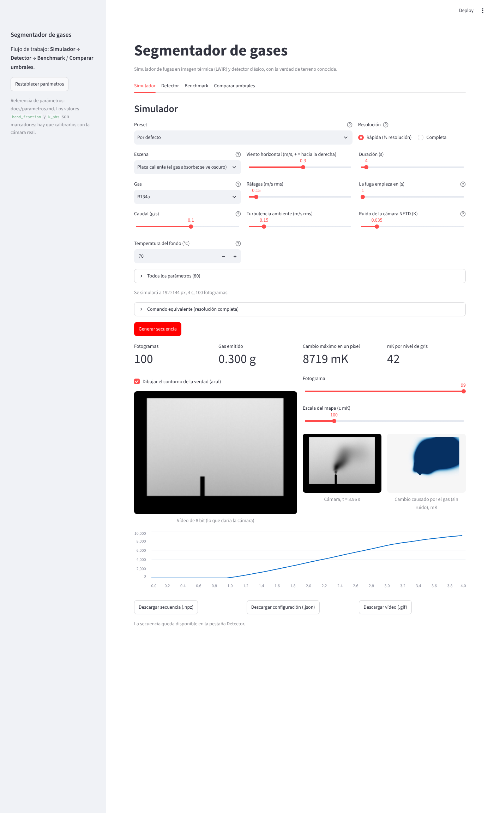
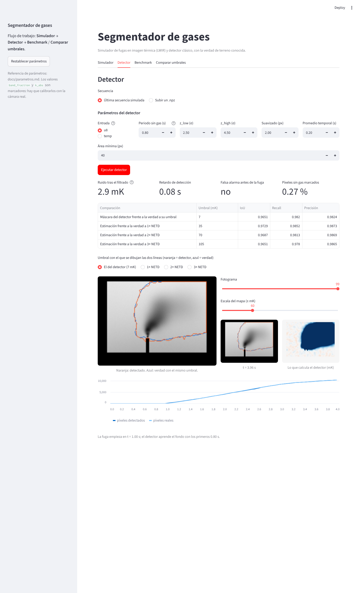

# Interfaz (`app.py`)

Aplicación en Streamlit para usar el simulador y el detector sin la línea de comandos.

## Cómo abrirla en tu ordenador

Necesitas Python 3.10 o superior.

```bash
git clone https://github.com/eneko1982/Segmentador_gases
cd Segmentador_gases
git checkout claude/loving-allen-jv3c71        # la rama de trabajo
python -m venv .venv
source .venv/bin/activate                       # en Windows: .venv\Scripts\activate
pip install -r requirements.txt
streamlit run app.py
```

Se abre en el navegador (por defecto, http://localhost:8501).

## Pestañas

| Pestaña | Qué hace |
|---|---|
| **Simulador** | Preset + 10 controles principales (escena, gas, caudal, viento, ráfagas, turbulencia, temperatura del fondo, NETD, duración, inicio de la fuga) + los 80 parámetros agrupados. Vista previa rápida (½ resolución, ~4 veces más rápida) o completa. Muestra el vídeo con el contorno de la verdad, el mapa del cambio causado por el gas y los píxeles con gas en el tiempo. Descarga `.npz`, `.json` y `.gif`. Enseña el comando equivalente. |
| **Detector** | Corre `gas_detect.py` sobre la última secuencia simulada o sobre un `.npz` subido. Parámetros: entrada (u8/temp), periodo sin gas, `z_low`, `z_high`, suavizado, promedio temporal, área mínima. Muestra ruido tras el filtrado, retardo, falsa alarma, % de píxeles sin gas marcados y una tabla de IoU, recall y precisión. Las líneas naranja (detector) y azul (verdad) se dibujan con el mismo umbral, a elegir. |
| **Benchmark** | Gráfica y tabla de `results/results.csv` por caudal y escena, con la métrica y la entrada a elegir. Botón para relanzar el barrido (≈2 min con 4 procesos). |
| **Comparar umbrales** | La figura de detector frente a verdad con el mismo umbral, para la escena y los caudales que elijas. |

## Capturas




## Limitaciones conocidas

- Solo carga secuencias `.npz` de `ogi_sim.py`. Los vídeos reales (`.mp4`, cámara en directo) llegarán con el programa de captura (paso 6 de la hoja de ruta).
- La secuencia simulada vive en la memoria de la sesión del navegador: al recargar la página se pierde (descárgala si quieres conservarla).
- Con resolución completa, una secuencia de 5 s ocupa unos 140 MB en memoria; las muy largas necesitan la escritura por trozos (paso A3).

## Abrirla sin instalar nada

El repositorio es público y su rama por defecto es `claude/loving-allen-jv3c71`. Hay tres vías, de la más cómoda a la menos.

### 1. GitHub Codespaces (recomendada: la interfaz completa, desde el navegador)

Abre https://codespaces.new/eneko1982/Segmentador_gases?quickstart=1 o, en la página del repositorio, **Code → Codespaces → Create codespace**. Necesitas una cuenta de GitHub.

- Se crea una máquina en la nube con Python, instala las dependencias (`.devcontainer/devcontainer.json`) y arranca la interfaz sola. Tarda unos minutos la primera vez.
- Si no se abre la vista previa, ve a la pestaña **Ports**, busca el puerto 8501 y pulsa el icono del globo (*Open in Browser*).
- Las cuentas gratuitas tienen una cuota mensual de horas (consúltala en tu configuración de GitHub). Detén o borra el codespace cuando termines, para no gastarla.
- Es una máquina completa: se pueden relanzar el benchmark y los tests.

### 2. Google Colab (simular, detectar y ver las figuras; la interfaz es opcional)

Cuaderno: `notebooks/colab.ipynb`. Para abrirlo:

- Entra en https://colab.research.google.com → **Archivo → Abrir cuaderno → pestaña GitHub**, escribe `eneko1982/Segmentador_gases`, elige la rama `claude/loving-allen-jv3c71` y el cuaderno `notebooks/colab.ipynb`. (El enlace directo `colab.research.google.com/github/...` puede fallar con ramas que llevan `/` en el nombre; con una rama `main` sí funciona.)
- Ejecuta las celdas en orden. Las celdas 1 a 5 instalan el proyecto, simulan una fuga, muestran la secuencia, ejecutan el detector y comparan los umbrales; los parámetros se cambian editando un diccionario.
- La celda 6 es una **interfaz con deslizadores dentro del propio cuaderno** (preset, gas, caudal, viento, ráfagas, turbulencia, duración, NETD…). No necesita servidor web ni túnel. Es la versión reducida de la interfaz: simula y detecta; no incluye las pestañas Benchmark ni Comparar umbrales (esta última está en la celda 5).
- Se comprobó ejecutando el cuaderno completo en un núcleo de Jupyter local. En Colab mismo no se ha podido probar.

> **Redes corporativas.** Los servicios de túnel (`localtunnel`, `ngrok`…) suelen estar bloqueados por los cortafuegos de empresa: por eso el cuaderno ya no los usa. Si tu red también bloquea Codespaces o Streamlit Cloud, las opciones son pedir una revisión a Ciberseguridad (el propio aviso de bloqueo explica cómo) o ejecutar la interfaz en local (`streamlit run app.py`), que no sale a Internet.

### 3. Streamlit Community Cloud (una dirección web fija que compartes con otras personas)

1. Entra en https://share.streamlit.io con tu cuenta de GitHub.
2. **Create app → Deploy a public app from GitHub**.
3. Repositorio `eneko1982/Segmentador_gases`, rama `claude/loving-allen-jv3c71`, archivo principal `app.py`. Despliega.

Es gratuito, pero los recursos son limitados (poca memoria y CPU): usa la vista previa rápida y secuencias cortas, y no relances el benchmark. Cualquiera con el enlace podrá usar la aplicación; no guarda nada fuera de la sesión.

## Servidor propio

`streamlit run app.py --server.port 8501 --server.address 0.0.0.0`. Sin protección, cualquiera con acceso a la red podría abrirla: ponla detrás de una contraseña o una VPN.
