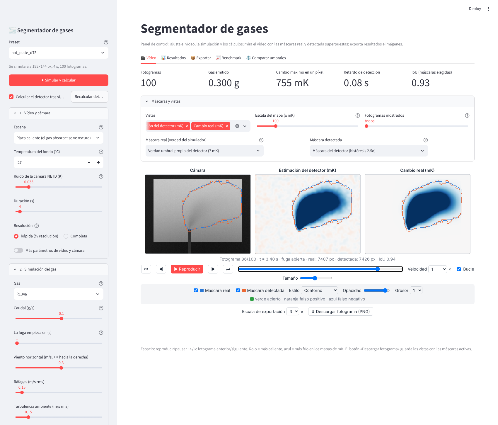
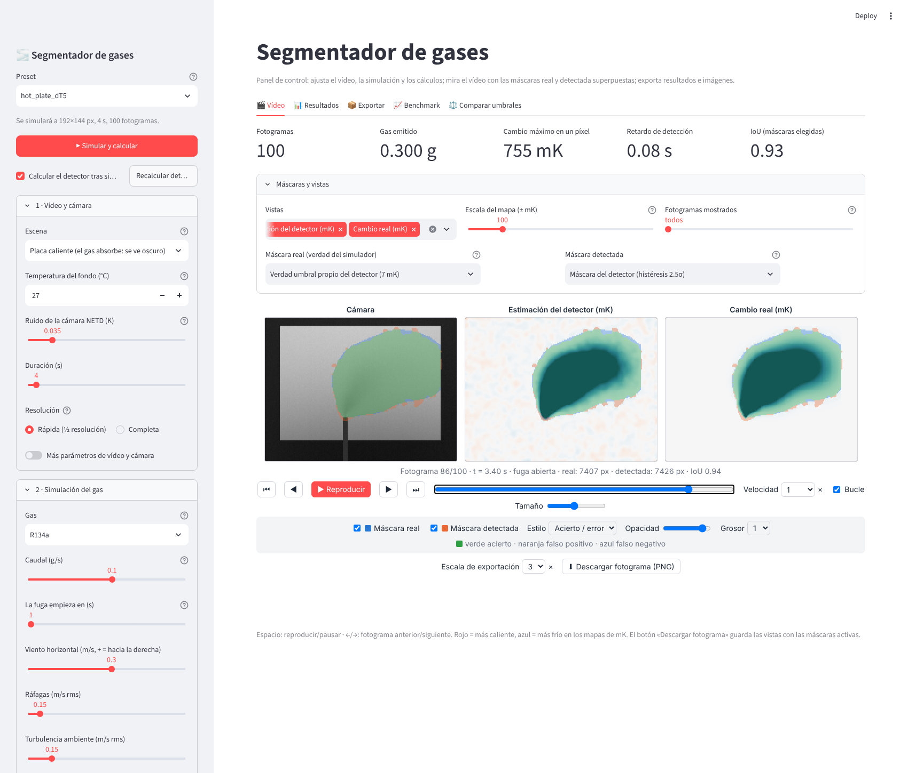
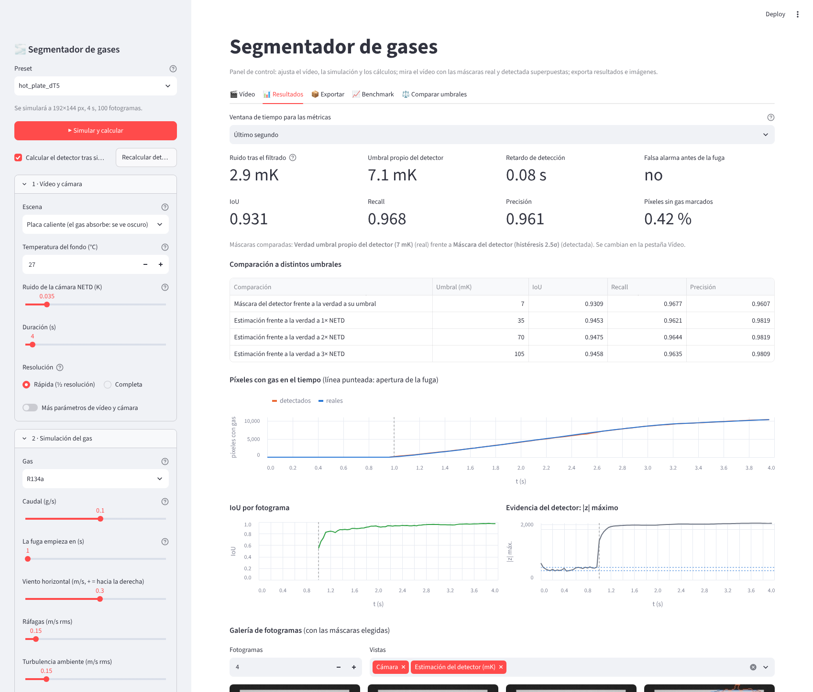
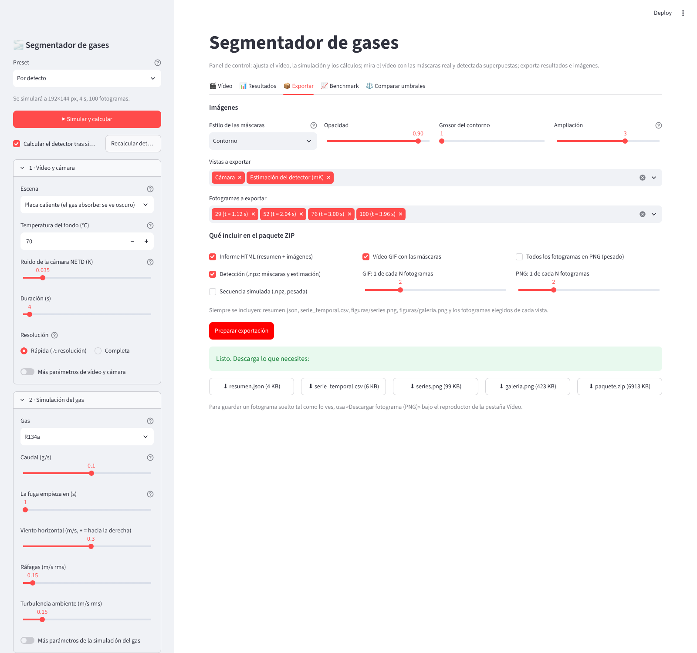
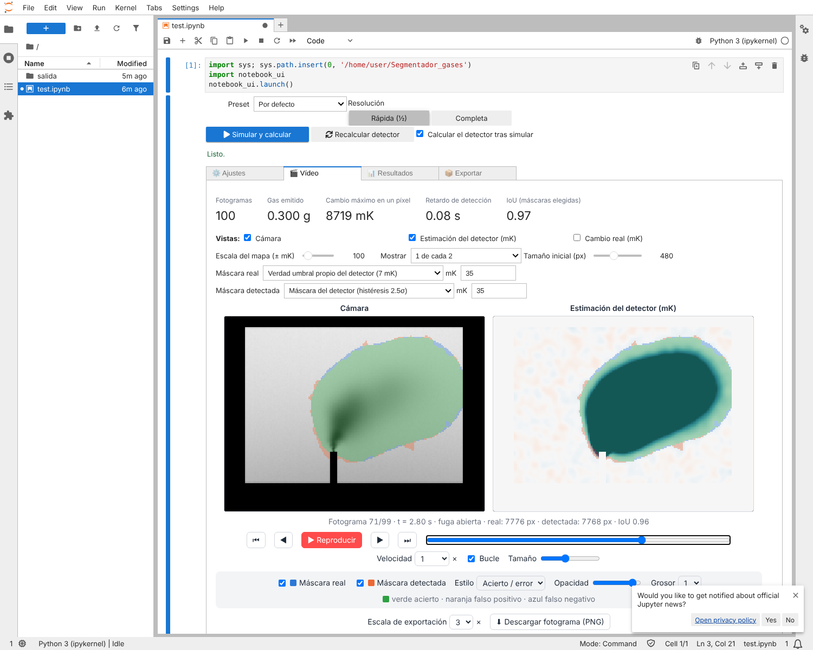
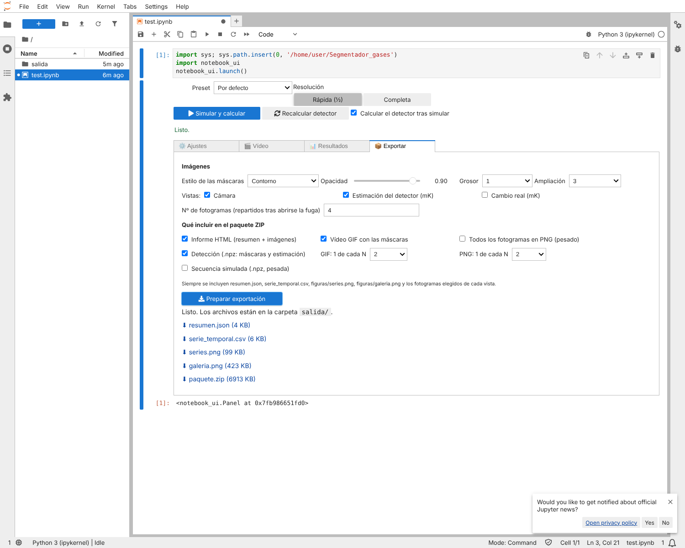

# Interfaz (`app.py`)

Panel de control en Streamlit para ajustar el vídeo, la simulación y los cálculos, ver el vídeo con las máscaras superpuestas y exportar resultados e imágenes, sin la línea de comandos.

## Cómo abrirla en tu ordenador (sin Colab)

Se ejecuta en tu propio equipo y se ve en el navegador en `http://localhost:8501`. Ese tráfico no sale a Internet, así que los cortafuegos corporativos (Zscaler) no intervienen. Solo hace falta **Python 3.10 o superior** y poder instalar los paquetes con `pip`.

### Windows (ordenador de empresa): pasos

1. **Obtén el proyecto.** Una de estas dos:
   - Descarga el ZIP: https://github.com/eneko1982/Segmentador_gases/archive/refs/heads/claude/loving-allen-jv3c71.zip (o en la página del repositorio, **Code → Download ZIP**) y descomprímelo en una carpeta tuya, por ejemplo `C:\Users\tu_usuario\Segmentador_gases`.
   - Si tienes Git: `git clone https://github.com/eneko1982/Segmentador_gases` y `git checkout claude/loving-allen-jv3c71`.
   - Si tu equipo no llega a GitHub, pide el ZIP por otro medio (por ejemplo, adjunto de correo o carpeta compartida).
2. **Comprueba que tienes Python.** Abre *Símbolo del sistema* o *PowerShell* y escribe `py -3 --version` (o `python --version`). Si no aparece una versión 3.10 o superior, instálalo desde el **Centro de software** de la empresa (marca «Add Python to PATH» si te lo pregunta) o pídelo a TI.
3. **Abre el panel con doble clic en `iniciar_panel.bat`.**
   - La primera vez crea una carpeta `.venv` con un entorno propio e instala las dependencias (unos minutos).
   - Después abre el panel en el navegador. Si no se abre solo, escribe `http://localhost:8501` en la barra de direcciones.
   - Si Streamlit te pide un correo electrónico en la ventana, pulsa Intro sin escribir nada.
   - Si Windows pregunta por el Firewall, puedes pulsar **Cancelar**: el panel funciona igualmente en tu equipo.
   - Para cerrarlo, cierra la ventana negra.

### Windows: a mano, si el `.bat` no se puede ejecutar

En PowerShell, dentro de la carpeta del proyecto (no hace falta activar el entorno, así se evitan las restricciones de ejecución de scripts):

```powershell
py -3 -m venv .venv
.\.venv\Scripts\python.exe -m pip install -r requirements.txt
.\.venv\Scripts\python.exe -m streamlit run app.py
```

### Linux / macOS

```bash
./iniciar_panel.sh        # la primera vez instala las dependencias
```

### Si algo falla

| Problema | Qué hacer |
|---|---|
| `pip` no puede descargar paquetes (error de SSL, de proxy o «no matching distribution») | La red de empresa suele exigir un proxy o un repositorio interno de paquetes. Pregunta a TI cómo configurar `pip` (te darán la dirección del proxy o del índice, que se configura con `pip config set global.index-url ...` o con la opción `--proxy`). No hace falta saltarse nada: es una configuración normal en entornos corporativos. |
| No se puede instalar Python | Pídelo a TI o por el Centro de software. Si la empresa ya tiene Anaconda/Miniconda aprobado, funciona igual: crea un entorno con Python 3.10+ y ejecuta los mismos comandos. |
| El puerto 8501 está ocupado | `...python.exe -m streamlit run app.py --server.port 8502` y entra en `http://localhost:8502`. |
| El antivirus bloquea el `.bat` | Usa los comandos de PowerShell de arriba. |
| La primera simulación tarda | Es normal con la resolución completa; la vista rápida (½) va unas 4 veces más rápida. |

## Cómo está organizada

**Barra lateral (los ajustes)** — tres bloques, más un preset y los botones de ejecución:

| Bloque | Qué ajusta |
|---|---|
| **1 · Vídeo y cámara** | Escena (placa caliente / cielo frío), temperatura del fondo, ruido NETD, duración, resolución (rápida ½ o completa). Con «Más parámetros» se abren los demás: fps, tamaño del píxel, ruido de patrón fijo y de columna, deriva, desenfoque, ventana de 8 bit, geometría de la placa, etc. |
| **2 · Simulación del gas** | Gas, caudal, inicio de la fuga, viento, ráfagas y turbulencia. Con «Más parámetros»: cierre de la fuga, velocidad y ángulo de salida, flotabilidad, crecimiento de la pluma, resolución de la pluma, modos de turbulencia… |
| **3 · Cálculos del detector** | Entrada (u8 / temp), periodo sin gas (automático o manual), umbrales `z_low` y `z_high`, suavizado espacial, promedio temporal y área mínima. |

Botones: **▶ Simular y calcular** (simula y, si está marcado, calcula el detector), **Recalcular detector** (cuando solo cambias el bloque 3, sin volver a simular), **Cargar una secuencia .npz**, **Restablecer parámetros** y el comando equivalente para repetirlo desde la terminal.

**Pestañas**

| Pestaña | Qué hace |
|---|---|
| **🎬 Vídeo** | Reproductor con una, dos o tres vistas sincronizadas: *Cámara* (8 bit), *Estimación del detector* y *Cambio real* (mapas en mK). Sobre cada vista se superponen la **máscara real** (azul) y la **máscara detectada** (naranja), que se activan y desactivan con casillas, sin recalcular. Estilos: contorno, relleno y **acierto/error** (verde = acierto, naranja = falso positivo, azul = falso negativo). También: opacidad, grosor, tamaño, velocidad, bucle, fotograma a fotograma (←/→) y espacio para reproducir. **Qué es «gas real» y qué es «detectado»** se elige encima del vídeo: la verdad del simulador, el umbral propio del detector, 1×/2×/3× NETD o un valor en mK; y la máscara del detector o la estimación con un umbral. El botón **Descargar fotograma (PNG)** guarda las vistas con las máscaras activas. |
| **📊 Resultados** | Ruido, umbral propio, retardo, falsa alarma, IoU/recall/precisión (para las máscaras elegidas y la ventana de tiempo que elijas), tabla a distintos umbrales, píxeles reales y detectados en el tiempo, IoU por fotograma, evidencia del detector (|z| máximo) y una galería de fotogramas con las máscaras. |
| **📦 Exportar** | Estilo de las imágenes, vistas y fotogramas a elegir, y qué incluir: informe HTML, GIF con las máscaras, todos los fotogramas en PNG, y los datos (`.npz`) de la detección y de la secuencia. Genera por separado `resumen.json`, `serie_temporal.csv`, `series.png`, `galeria.png` y un `paquete.zip` con todo. |
| **📈 Benchmark** | Resultados de `results/results.csv` por caudal y escena; botón para relanzar el barrido. |
| **⚖️ Comparar umbrales** | La figura de detector frente a verdad con el mismo umbral, para la escena y los caudales que elijas. |

## Capturas






## Contenido del paquete exportado

```
resumen.json                 métricas, parámetros del detector y del simulador
serie_temporal.csv           por fotograma: píxeles detectados/reales, acierto, FP, FN, IoU, recall, precisión, |z| máx, alarma
informe.html                 informe autónomo con tablas e imágenes
figuras/series.png           píxeles, IoU y |z| en el tiempo
figuras/galeria.png          fotogramas elegidos con las máscaras
figuras/fotogramas/*.png     un PNG por vista y fotograma elegido
video/superposicion.gif      vídeo con las máscaras
fotogramas_png/*.png         (opcional) todos los fotogramas
datos/deteccion.npz          máscara detectada, máscara real y estimación en mK
datos/secuencia.npz          (opcional) la secuencia simulada completa
```

## Limitaciones conocidas

- Solo carga secuencias `.npz` de `ogi_sim.py`. Los vídeos reales (`.mp4`, cámara en directo) llegarán con el programa de captura (paso 6 de la hoja de ruta).
- La secuencia simulada vive en la memoria de la sesión del navegador: al recargar la página se pierde (exporta el `.npz` o el paquete si quieres conservarla).
- El reproductor carga todos los fotogramas en el navegador: con vídeos largos o a resolución completa usa «Fotogramas mostrados: 1 de cada N» y pocas vistas.
- «Superponer» las máscaras es una visualización: no se pueden dibujar ni editar máscaras a mano.

## Abrirla sin instalar nada

El repositorio es público y su rama por defecto es `claude/loving-allen-jv3c71`. Hay tres vías, de la más cómoda a la menos.

### 1. GitHub Codespaces (recomendada: la interfaz completa, desde el navegador)

Abre https://codespaces.new/eneko1982/Segmentador_gases?quickstart=1 o, en la página del repositorio, **Code → Codespaces → Create codespace**. Necesitas una cuenta de GitHub.

- Se crea una máquina en la nube con Python, instala las dependencias (`.devcontainer/devcontainer.json`) y arranca la interfaz sola. Tarda unos minutos la primera vez.
- Si no se abre la vista previa, ve a la pestaña **Ports**, busca el puerto 8501 y pulsa el icono del globo (*Open in Browser*).
- Las cuentas gratuitas tienen una cuota mensual de horas (consúltala en tu configuración de GitHub). Detén o borra el codespace cuando termines, para no gastarla.
- Es una máquina completa: se pueden relanzar el benchmark y los tests.

### 2. Google Colab (recomendada si no puedes ejecutar nada en tu ordenador)

El cuaderno `notebooks/colab.ipynb` trae el **panel completo dentro del propio cuaderno**, sin servidor web ni túnel (los túneles los bloquean los cortafuegos de empresa). Solo necesitas poder abrir Colab en el navegador.

1. Entra en https://colab.research.google.com → **Archivo → Abrir cuaderno → pestaña GitHub**, escribe `eneko1982/Segmentador_gases`, elige la rama `claude/loving-allen-jv3c71` y el cuaderno `notebooks/colab.ipynb`. (El enlace directo `colab.research.google.com/github/...` puede fallar con ramas que llevan `/` en el nombre; con una rama `main` sí funciona.)
2. **Ejecutar todo** (*Entorno de ejecución → Ejecutar todo*, o Ctrl+F9). La celda 1 instala el proyecto; las celdas 2 a 5 son ejemplos con código; **la celda 6 es el panel**.
3. En el panel: **⚙️ Ajustes** (los tres bloques) → **Simular y calcular** → **🎬 Vídeo** (reproductor con las máscaras real y detectada superpuestas) → **📊 Resultados** → **📦 Exportar**.
   - Las máscaras se activan y desactivan con casillas, sin recalcular; hay contorno, relleno y acierto/error.
   - Al exportar, los archivos quedan en la carpeta `salida/` (panel de archivos de la izquierda de Colab) y aparecen botones de descarga.
   - Si el reproductor tarda o no carga, elige «Mostrar: 1 de cada 4» y menos vistas. Los vídeos largos o a resolución completa pesan en el navegador.
4. Si vuelves a abrir el cuaderno más adelante, la celda 1 actualiza el código con `git pull`. Para empezar de cero: *Entorno de ejecución → Desconectar y eliminar el entorno de ejecución*.

**Qué se ha comprobado y qué no.** El panel se ha ejecutado en JupyterLab (con ipywidgets 8) y se ha construido y simulado con ipywidgets 7.7, la versión que usa Colab; el cuaderno completo se ejecuta sin errores en un núcleo de Jupyter. **No se ha podido probar en Colab mismo.** Si algo falla allí, lo más probable es el reproductor (el tamaño de la salida o las restricciones del navegador) o los botones de descarga; la carpeta `salida/` es la vía alternativa.




> **Redes corporativas.** Los servicios de túnel (`localtunnel`, `ngrok`…) suelen estar bloqueados por los cortafuegos de empresa, y por eso el cuaderno ya no los usa. Si tu red también bloquea Codespaces o Streamlit Cloud, las opciones son Colab (este panel), pedir una revisión a Ciberseguridad (el propio aviso de bloqueo explica cómo) o ejecutar el panel en un equipo donde se pueda instalar Python.

### 3. Streamlit Community Cloud (una dirección web fija que compartes con otras personas)

1. Entra en https://share.streamlit.io con tu cuenta de GitHub.
2. **Create app → Deploy a public app from GitHub**.
3. Repositorio `eneko1982/Segmentador_gases`, rama `claude/loving-allen-jv3c71`, archivo principal `app.py`. Despliega.

Es gratuito, pero los recursos son limitados (poca memoria y CPU): usa la vista previa rápida y secuencias cortas, y no relances el benchmark. Cualquiera con el enlace podrá usar la aplicación; no guarda nada fuera de la sesión.

## Servidor propio

`streamlit run app.py --server.port 8501 --server.address 0.0.0.0`. Sin protección, cualquiera con acceso a la red podría abrirla: ponla detrás de una contraseña o una VPN.
